# Menu Explorer

A browsable restaurant menu built with **ASP.NET Core MVC (Razor)**. The exercise weights MVC/Razor
structure over visual polish, so the app demonstrates server-side composition: a reusable item-card
partial, a layout-level category filter, a ViewComponent, a custom tag helper, and progressively
enhanced search — with no database, no Entity Framework and no CSS framework.

Menu data lives in `MenuExplorer/Data/menu.json` (16 dishes across 4 categories) and is validated at
startup. Each dish also has a photograph in `wwwroot/images/menu/`, mapped through the same file.

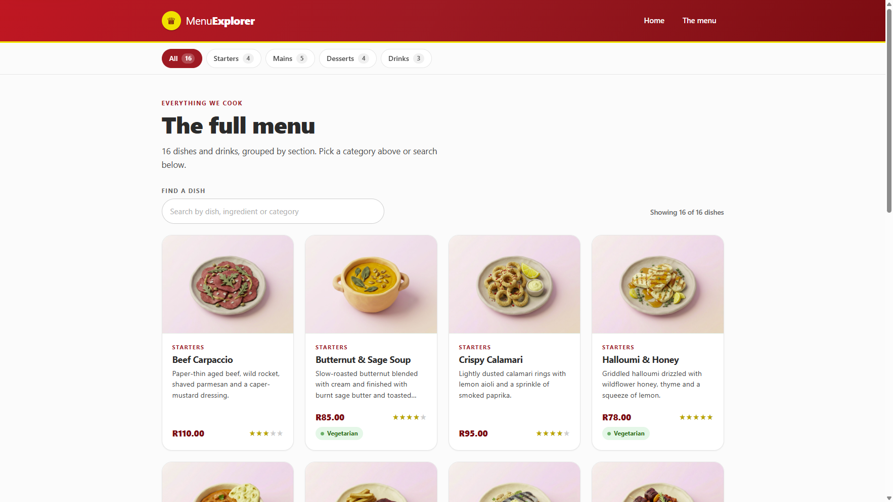

| | |
|---|---|
| Framework | ASP.NET Core 9 MVC, Razor views, C# 13 |
| Data | JSON read once at startup and validated; no database |
| Images | 16 dish photographs, mapped by file name in the JSON, checked for existence at startup |
| Styling | One hand-written stylesheet (~1,130 lines), no framework, no CDN |
| Search | Client-side, progressive enhancement, no round trip |
| Tests | 153 xUnit tests: 81 unit + 70 integration + 2 convention |
| Runtime dependencies | None beyond the shared ASP.NET Core framework |

## Contents

1. [Overview](#1-overview)
2. [Screenshots](#2-screenshots)
3. [Requirements traceability](#3-requirements-traceability)
4. [Getting started](#4-getting-started)
5. [Project structure](#5-project-structure)
6. [Architecture](#6-architecture)
7. [Data model and JSON contract](#7-data-model-and-json-contract)
8. [Razor composition](#8-razor-composition)
9. [Client-side search](#9-client-side-search)
10. [Design system and brand palette](#10-design-system-and-brand-palette)
11. [Accessibility](#11-accessibility)
12. [Testing](#12-testing)
13. [Operational notes](#13-operational-notes)
14. [Design decisions and limitations](#14-design-decisions-and-limitations)
15. [Stretch goals](#15-stretch-goals)

---

## 1. Overview

- Lists every dish in a responsive card grid at `/Menu`, each with its own photograph.
- Filters the grid server-side by category (`/Menu?category=Desserts`).
- Opens a details page per item at `/Menu/Details/{id}`, with related dishes.
- Shows a "Today's specials" section on the home page, rendered through a ViewComponent that
  reuses the same card partial.
- Renders the category bar on **every** page by including a partial from `_Layout.cshtml`.
- Filters the visible cards client-side as you type, without a page reload.
- Degrades gracefully: without JavaScript the grid and filters still work; only search disappears.

Thin controllers, typed view models, one source of truth per piece of markup, and validation at the
boundary where data enters the system.

---

## 2. Screenshots

| Home — hero, stats and today's specials | Menu — card grid with dish photographs |
|---|---|
| 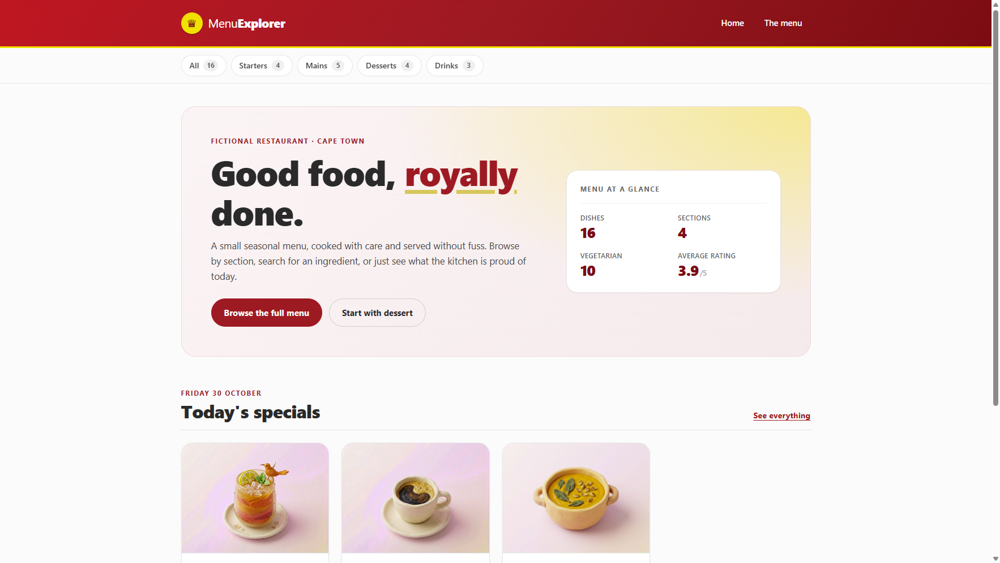 |  |

| Details page | Mobile (414 px) |
|---|---|
| 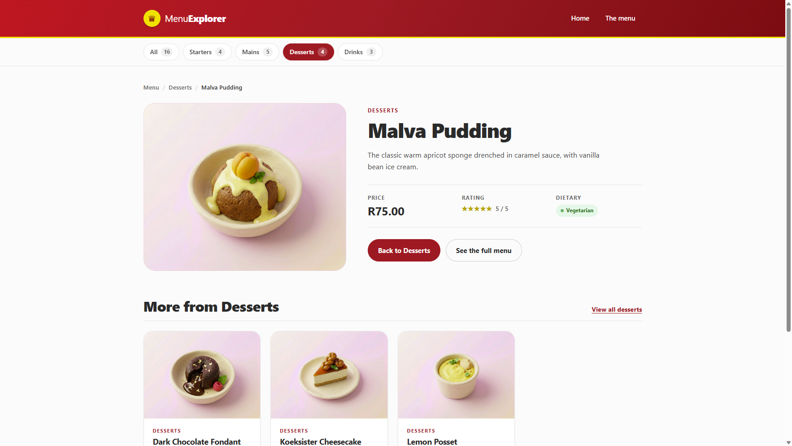 | 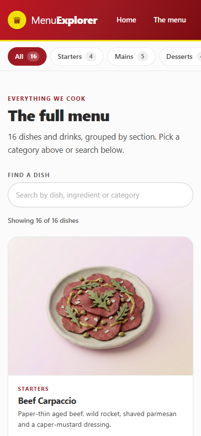 |

---

## 3. Requirements traceability

| # | Requirement | Implementation |
|---|---|---|
| 1 | JSON-backed data, no hardcoded C# list | `Data/menu.json` read by `MenuJsonReader` / `JsonMenuService` |
| 2 | `MenuItem` with Id, Name, Description, Price, Category, IsVegetarian, Rating | `Models/MenuItem.cs` (immutable, `required` members) |
| 3 | Index page: card grid | `Views/Menu/Index.cshtml` + `_MenuItemCard.cshtml` |
| 4 | Category filter via query string | `?category=Desserts`, parsed to `MenuCategory?` |
| 5 | Details page per item | `/Menu/Details/5` → `MenuDetailsViewModel` |
| 6 | Item card partial reused elsewhere | Grid, details page, and the ViewComponent all render `_MenuItemCard` |
| 7 | Category filter partial shared via the layout | `_CategoryNav` rendered from `_Layout.cshtml` on every page |
| 8 | Custom CSS, no Bootstrap | Single hand-written stylesheet, zero framework references |
| 9 | King Price brand palette | Tokens from King Price's production stylesheet — [Section 10](#10-design-system-and-brand-palette) |
| 10 | ViewComponent stretch goal | `MenuItemCardViewComponent` on the home page |
| 11 | Custom tag helper stretch goal | `<star-rating value="4" />` |
| 12 | Client-side search stretch goal | `wwwroot/js/menu-search.js`, no round trip |
| 13 | Friendly empty state | `_EmptyState` partial for empty categories and empty searches |
| 14 | Run instructions | [Section 4](#4-getting-started) |

---

## 4. Getting started

### 4.1 Prerequisites

- [.NET SDK 9.0](https://dotnet.microsoft.com/download/dotnet/9.0) — `global.json` pins `9.0.100`
  with `rollForward: latestFeature`
- Any OS: Windows, macOS or Linux
- Optional: Visual Studio 2022 17.12+, JetBrains Rider, or VS Code with the C# Dev Kit

No database server, no Node.js, no npm and no CDN access. The app runs fully offline once restored.

### 4.2 Conventions

- **Explicit types, never `var`** — including locals, `foreach` variables, `out` parameters,
  `using` declarations and Razor `@{ }` blocks.
- **`this.` for constructor-assigned fields**, so a field cannot be mistaken for its parameter.
- **Named arguments for booleans and literals** (`count: 3`), so a call site reads as prose.
- **Comment the *why*,** especially where a decision looks odd at a glance.
- **Immutable data**: `init` setters, `required` members and `IReadOnly*` on every public collection,
  wrapped so the read-only claim survives a downcast.
- **Every C#, Razor, JavaScript and CSS file opens with a flowerbox** — a bordered comment naming the
  file's role, its layer, and the one thing worth knowing when it misbehaves. Expected format:

  ```csharp
  /* ==========================================================================
   *  Menu Explorer — JsonMenuService
   * ==========================================================================
   *  Role    Load the menu JSON once, validate it, and serve it from memory.
   *  Layer   Services. Owns file I/O; knows nothing about HTTP or HTML.
   *  Lifetime Singleton (see Program.cs).
   *  Debug   Startup logs one structured line with the item count and path.
   * ========================================================================== */
  ```

  Razor files use the same box inside `@* ... *@`; `site.css` and `menu-search.js` use `/* ... */`.
- **No file ends with a blank last line**: every text file ends on its last line of content, UTF-8
  with no byte-order mark. This is enforced twice — `.editorconfig` sets `insert_final_newline = false`
  and `charset = utf-8` (so `dotnet format` and most editors comply), and
  `RepositoryConventionsTests` walks the repository and fails the suite if any file drifts back.
- **Warnings are errors** (`Directory.Build.props`), so a nullable warning or an undocumented public
  member fails the build rather than scrolling past in a log.
- **XML documentation is part of the code, not an afterthought**: `<summary>` on every public type and
  member, `<param>`/`<returns>`/`<exception>` where they add information, `<remarks>` for invariants
  and trade-offs, `<see cref="..."/>` for anything a reader would otherwise have to search for, and
  `<inheritdoc/>` where a member simply implements its contract. The `Models` types also carry
  `<example>` blocks showing both the JSON that produces them and the C# that consumes them, so the
  entity and the data file can be read side by side.

### 4.3 Run, test, publish

```bash
# from the repository root
dotnet restore
dotnet run --project MenuExplorer

# pin a port
dotnet run --project MenuExplorer --urls http://localhost:5177

# tests
dotnet test

# publish
dotnet publish MenuExplorer -c Release -o ./artifacts/publish
```

Opening `MenuExplorer.sln` and pressing F5 works too.

Test output:

```
Passed!  - Failed: 0, Passed: 153, Skipped: 0, Total: 153
```

The published app is self-contained — `Data/menu.json` and `wwwroot/` (including the dish
photographs) are copied to the output — and runs from any working directory, because the content root
is anchored to `AppContext.BaseDirectory`:

```bash
dotnet ./artifacts/publish/MenuExplorer.dll --urls http://localhost:5178
```

### 4.4 URLs worth visiting

| URL | What it demonstrates |
|---|---|
| `/` | Home page, hero stats, "Today's specials" ViewComponent |
| `/Menu` | Full grid, shared category bar, search |
| `/Menu?category=Desserts` | Server-side filtering |
| `/Menu?category=desserts` | Case-insensitive category parsing |
| `/Menu?category=Burgers` | Graceful fallback for an unknown category |
| `/Menu/Details/5` | Details page with related items |
| `/Menu/Details/999` | Friendly 404 |
| `/health` | Health check endpoint |

---

## 5. Project structure

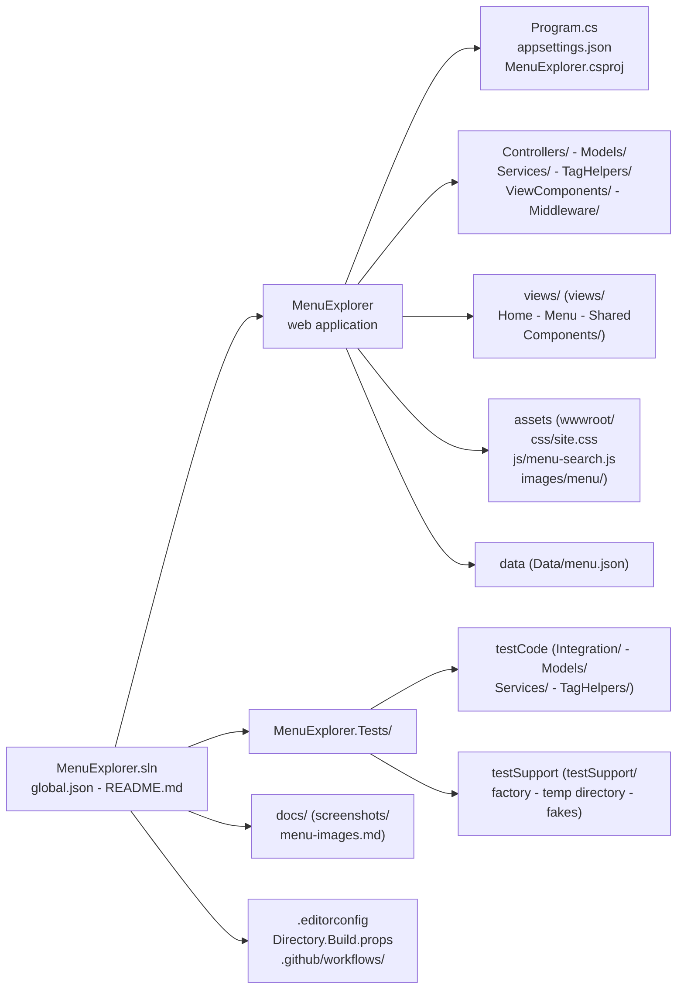

Individual Razor views and test files are omitted here; [Section 8](#8-razor-composition) shows how the
views compose and [Section 12](#12-testing) inventories the tests.

`wwwroot/images/menu/` holds the 16 dish photographs, one per item, named `{id:00}-{slug}.jpg` and
mapped by the `imageFile` field in the JSON. Startup fails if a mapped file is missing, so the folder
and the data file cannot drift apart. [docs/menu-images.md](docs/menu-images.md) covers the naming
convention, format guidance, and how to add or replace a photograph.

---

## 6. Architecture

### 6.1 Request pipeline

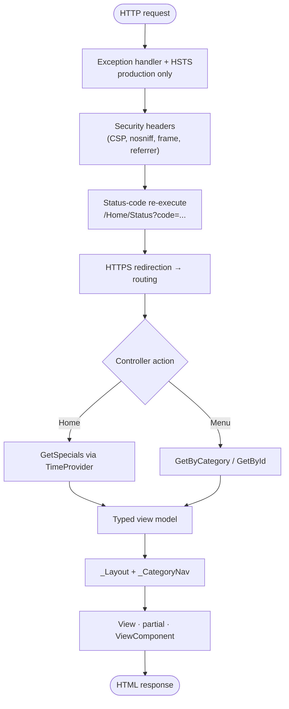

- The menu service is resolved immediately after `builder.Build()`, so bad data fails the process at
  startup rather than on a visitor's first request.
- `MenuNavigationContext` is the only channel from a controller to the shared navigation: the menu
  controller records the category it actually resolved, and `_CategoryNav` reads that instead of
  re-parsing the query string.
- `UseStatusCodePagesWithReExecute` turns bodiless 404s (including unknown routes) into friendly
  pages while preserving the original status code.
- `MenuController` only parses input, calls the service and chooses a view; formatting lives in Razor.

### 6.2 Layers

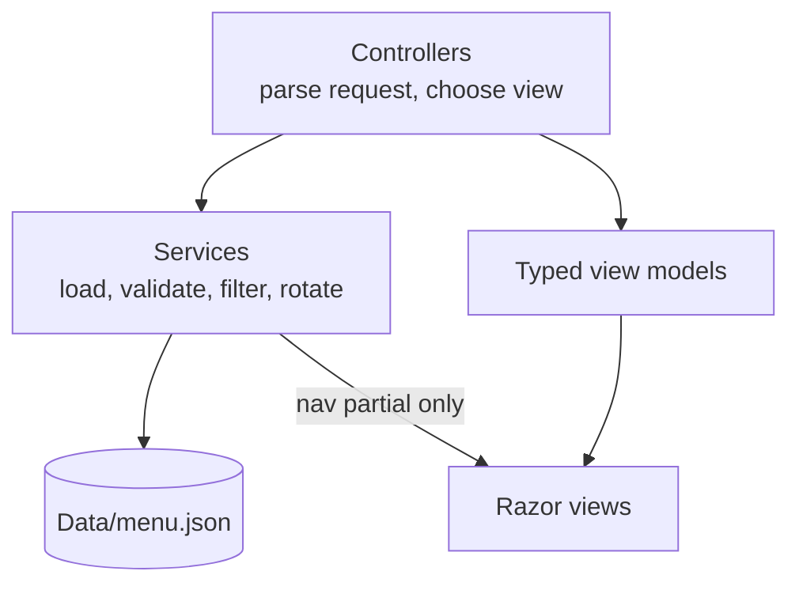

| Layer | Responsibility | Deliberately not responsible for |
|---|---|---|
| Controllers | Parse the request, choose a view, set status codes | Data access, filtering rules, formatting |
| Services | Load once, validate, filter, sort, rotate specials | HTTP concerns, HTML |
| Models | Domain entity and per-view view models | Business rules beyond invariants |
| Views | Presentation and composition | Fetching data (except the nav partial, below) |
| Tag helpers / ViewComponents | Self-contained rendering units | Data access |
| Client assets | Search enhancement, styling | Anything required for the page to work |

### 6.3 Dependency injection

| Service | Lifetime | Why |
|---|---|---|
| `IMenuService` → `JsonMenuService` | Singleton | The menu is immutable for the process; loading once removes per-request file I/O |
| `TimeProvider` | Singleton | Makes "today" injectable, so date-dependent logic is testable |
| `MenuHealthCheck` | Transient (health-check infrastructure) | Probes the singleton menu |
| `IOptions<MenuDataOptions>` | Singleton | Configuration binding |

### 6.4 Routing

```csharp
app.MapControllerRoute(
    name: "default",
    pattern: "{controller=Home}/{action=Index}/{id:int?}");
```

The `:int?` constraint means a non-numeric id never reaches model binding:
`/Menu/Details/abc` matches no route and becomes a plain 404 instead of binding `id` to `0` and
rendering "menu item 0". `Details` also treats a missing or non-positive id as a 404 in its own
right. `/health` is mapped separately by the health-check middleware, and `/Home/Status?code=...`
renders status pages produced by re-execution.

### 6.5 Error handling

| Situation | Behaviour | Status |
|---|---|---|
| Missing or invalid `menu.json` | Startup failure naming the path and the setting to fix | n/a |
| `imageFile` names a file that is not in `wwwroot/images/menu` | Startup failure naming the file, the item id and the item name | n/a |
| `imageFile` contains a path separator or `..` | Startup failure: the value must be a bare file name inside the images folder | n/a |
| Unknown category (`?category=Burgers`) | Full menu plus an inline explanation; "All" stays highlighted | 200 |
| Non-name category (`?category=1`, `?category=Starters,Mains`) | Same fallback — never silently mapped to a section | 200 |
| Unknown item id | Friendly page naming the id | 404 |
| Non-numeric or missing id | Generic friendly 404, rejected by the route constraint | 404 |
| Unknown route | Friendly page via status-code re-execution | 404 |
| Missing item on a details id | 404 page, and the nav highlights "All" rather than no pill | 404 |
| Status page hit directly, e.g. `/Home/Status?code=503` | Page renders and the response carries that exact code, so a monitor cannot read an error page as a success | 503 |
| Status page for any other error code (`?code=418`, `?code=502`, `?code=504`) | Rendered as-is: the middleware re-executes for every bodiless 4xx/5xx, so rewriting the ones that are not "ours" would report a gateway timeout as an internal error | as requested |
| Status page with a value that is not an error status (`?code=abc`, `?code=0`, `?code=-1`, `?code=302`) | Falls back to the 500 page; never renders "HTTP 0" or a status the middleware cannot supply | 500 |
| Status page rendering 401 | Carries `WWW-Authenticate: FormBased`, because RFC 9110 §15.5.2 requires a challenge on every 401 | 401 |
| Unhandled exception (production) | `/Home/Error` with a request reference, and a 500 on the wire | 500 |
| `/Home/Error` hit directly | Renders the same page and sets 500 rather than 200 | 500 |

`MenuCategoryParser` does **not** rely on `Enum.TryParse` alone. That method accepts numeric strings
and comma-separated combinations, and because `Starters == 0`, both `?category=1` and
`?category=Starters,Mains` would resolve to `Mains`; `Enum.IsDefined` validates the resulting value,
not the input form. The parser matches declared **names** only, and both the controller and the
navigation use it, so they cannot disagree about what a URL means.

---

## 7. Data model and JSON contract

### 7.1 The entity

```csharp
public sealed class MenuItem
{
    public int Id { get; init; }
    public required string Name { get; init; }
    public required string Description { get; init; }
    public decimal Price { get; init; }
    public required MenuCategory Category { get; init; }
    public string? ImageFile { get; init; }
    public bool IsVegetarian { get; init; }
    public int Rating { get; init; }

    public string? ImageUrl => ImageFile is null ? null : $"/images/menu/{ImageFile}";
    public string PriceDisplay => string.Create(CultureInfo.InvariantCulture, $"R{Price:0.00}");
}
```

`required` members and `init` setters make the entity immutable after construction — which is what
justifies the singleton service and means no defensive copying when instances are rendered into
multiple views. `ImageUrl` is composed once here so no view has to know where images live.

### 7.2 JSON shape

```json
[
  {
    "id": 5,
    "name": "Dry-Aged Sirloin",
    "description": "300g grass-fed sirloin aged for 28 days, served with hand-cut chips and cafe de Paris butter.",
    "price": 285.00,
    "category": "Mains",
    "imageFile": "05-dry-aged-sirloin.jpg",
    "isVegetarian": false,
    "rating": 5
  }
]
```

Deserialisation is lenient about formatting and strict about meaning:

| Rule | Behaviour |
|---|---|
| Property names | Case-insensitive (`id` or `Id`) |
| Comments / trailing commas | Allowed |
| Category values | Case-insensitive names only; unknown values fail and list the allowed set |
| Unknown JSON properties | Ignored (forward compatible) |
| Missing `name` / `description` / `category` | `MenuDataException` at startup |

### 7.3 Invariants enforced at load

`MenuJsonReader.Parse` validates every item and fails with a message that identifies the file and
the item:

| Invariant | Example failure message |
|---|---|
| At least one item | `does not contain any menu items.` |
| No `null` array elements | `contains a null entry at index 1; every array element must be a menu item object.` |
| Unique ids | `contains duplicate item id 5.` |
| `Id > 0` | `contains an item with a non-positive id (0).` |
| Name and description not blank | `contains item 3 ('   ') with a blank name.` |
| `Price >= 0` | `contains Item 2 ('Steak') with a negative price (-1).` |
| `1 <= Rating <= 5` | `contains Item 2 ('Steak') with rating 6; expected 1–5.` |
| Category is a declared name | `Unknown menu category 'Burgers'. Allowed categories: Starters, Mains, Desserts, Drinks.` |
| `imageFile`, if present, is one plain file name | `expected a bare file name inside images/menu (letters, digits, hyphens, dots), with no directory separators or '..'` |
| `imageFile` exists on disk | `references 1 image file(s) that do not exist under '…/wwwroot/images/menu': 12-lemon-posset.jpg (item 12 'Lemon Posset').` |

Validation is pure (`Stream` in, `IReadOnlyList<MenuItem>` out), so it is covered by fast unit tests
with no file system or host involved.

### 7.4 "Today's specials"

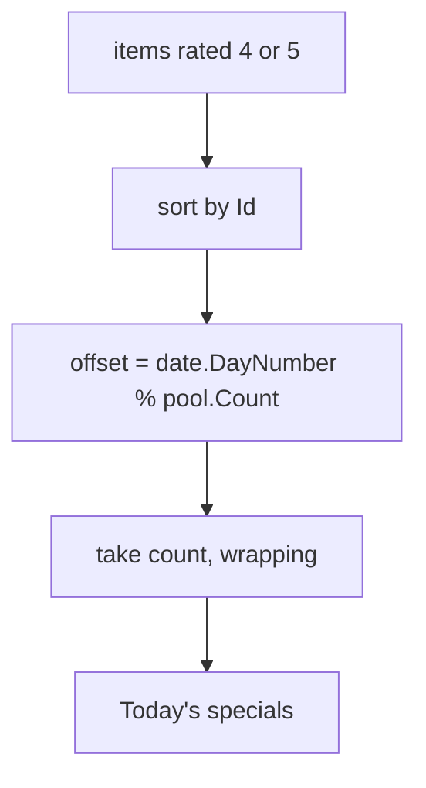

Specials are deterministic, not random:

- Stable for a given day, so a cached or screenshotted page does not flicker.
- Trivially testable, because the date is a parameter.
- Changes daily without any editor action.

`HomeController` supplies the date from the injected `TimeProvider`. If no item qualifies, the list
is empty and the home page renders the shared `_EmptyState` partial instead of a heading over a
blank grid.

### 7.5 Changing data

- **New dish** — append an object with a unique `id`. It appears in the grid, the category counts
  and the specials rotation automatically.
- **New category** — add a value to `MenuCategory`; navigation, parsing, counts and the JSON
  converter pick it up with no view changes.
- **Different currency** — prices are `decimal` rand values; change `PriceDisplay` and the footer copy.
- **New photograph** — add `{id:00}-{slug}.jpg` to `wwwroot/images/menu/` and set the matching
  `"imageFile"` on the item; then restart (see 7.6).

### 7.6 Photographs

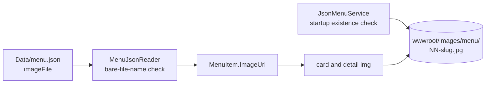

- `imageFile` is optional. An item without one renders the category glyph, so the entity still works
  for data with no photography; the shipping menu sets it on all 16 items.
- The value must be a single file name. `MenuJsonReader` rejects directory separators, `..` and empty
  extensions, so a composed URL can never point outside `/images/menu/`.
- The folders and the JSON are checked against each other at startup. A renamed file therefore fails
  the host with `JsonMenuService`'s message naming the file, item id and item name, rather than
  serving a broken image that only a browser would notice.
- Cards reserve the space before the bytes arrive: the media box is a fixed `aspect-ratio: 4 / 3`
  and the photograph fills it with `object-fit: cover`, so the master (1136 × 943) is cropped rather
  than stretched and the grid does not shift while images load.
- Card images are `loading="lazy"` and `alt=""`; the detail hero is eager with
  `fetchpriority="high"`, because it is the largest element above the fold. Both are decorative — see
  [Section 11](#11-accessibility) for why the alt text is empty.
- Photographs are served as static files. There is no resizing or format-negotiation pipeline; the
  files are pre-sized to roughly 1136 px wide at JPEG quality 82 (51–78 KB each, ~1.1 MB total),
  which is about twice the largest rendered width.

---

## 8. Razor composition

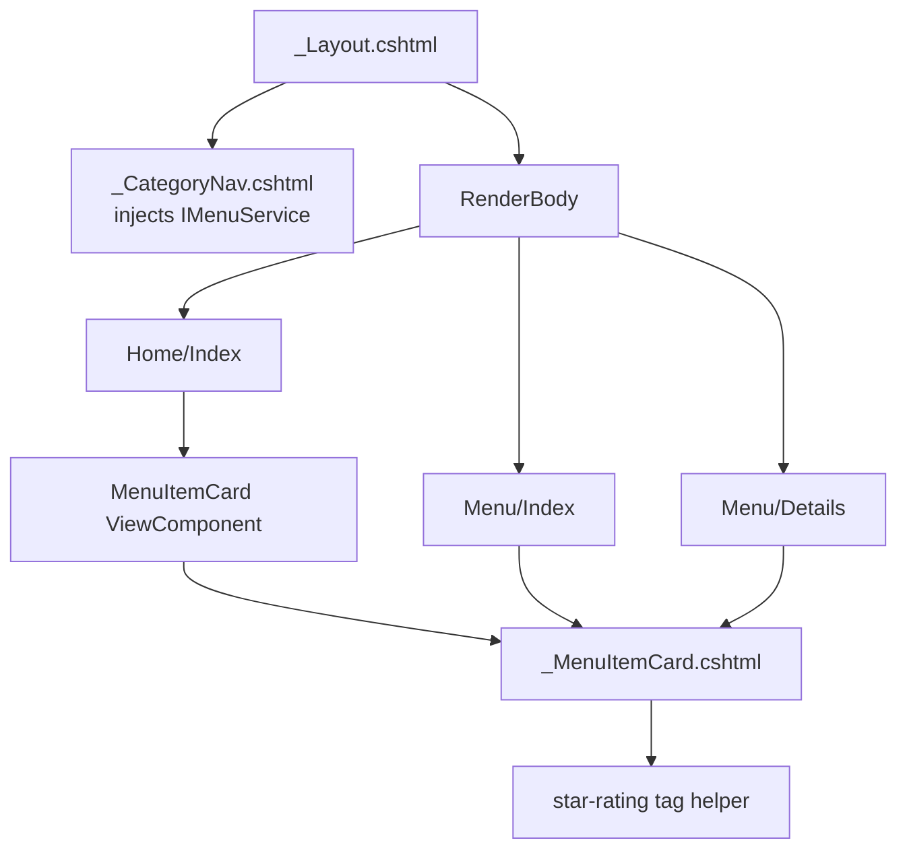

### 8.1 One card, many call sites

`_MenuItemCard.cshtml` is the only place card markup exists:

```cshtml
<article class="card" data-menu-card data-name="@Model.Name" ...>
    <a class="card__link" asp-controller="Menu" asp-action="Details" asp-route-id="@Model.Id">
        <div class="card__media" aria-hidden="true">
            
        </div>
        <h3 class="card__title">@Model.Name</h3>
        <span class="card__price">@Model.PriceDisplay</span>
        <star-rating value="@Model.Rating" />
    </a>
</article>
```

Without an `imageFile` the media box renders `<span class="card__glyph">🥗</span>` instead, so the
partial works for data that has no photography at all.

It is used by the menu grid, the "More from {category}" row on the details page, and the
ViewComponent's view. The `data-*` attributes exist for client-side search, keeping the JavaScript
generic instead of hardcoding DOM structure.

### 8.2 ViewComponent

```csharp
[ViewComponent(Name = "MenuItemCard")]
public sealed class MenuItemCardViewComponent : ViewComponent
{
    public IViewComponentResult Invoke(MenuItem item) => View(item);
}
```

The component's default view is a one-liner that renders the same partial. That adds an invocation
boundary — useful for testing or per-context variations later — without forking the markup. The grid
uses the partial directly because that is the simplest thing that works; the home page demonstrates
the component form.

### 8.3 Layout-level partial

`_Layout.cshtml` renders `_CategoryNav` inside the category bar, so the filter appears on every page
without any controller populating it. The partial injects `IMenuService` for the counts and
`MenuNavigationContext` for the current section:

```cshtml
@inject IMenuService MenuService
@inject MenuNavigationContext Navigation
@{
    IReadOnlyList<MenuCategory> categories = MenuService.GetCategories();
    IReadOnlyDictionary<MenuCategory, int> categoryCounts = MenuService.GetCategoryCounts();
    MenuCategory? activeCategory = Navigation.ActiveCategory;   // resolved by the controller
    bool isAllActive = Navigation.IsMenuPage && activeCategory is null;
}
```

The active state is never derived from the URL here, because the raw query string and the resolved
filter can disagree: `?category=Desserts&category=Mains` filters on the first value while the query
collection holds both, and `/Menu/Details/5?category=Drinks` would highlight a section the dish is
not in. Reading the controller's resolved category removes both cases, and each has an integration
test.

The trade-off is a view that performs data access. It is acceptable for global chrome — the service
is a cached singleton and the counts are precomputed, so a render allocates nothing — and it is
documented here so it is not mistaken for a general pattern. Page-specific content always flows
through a typed view model.

Active state is derived from the *resolved* category, not the raw query string. That covers
`/Menu?category=Mains`, `/Menu/Details/5` (resolved from the item), and the fallback case: an
unrecognised category shows the full menu, so "All" is highlighted rather than no pill at all.

### 8.4 Tag helper

```cshtml
<star-rating value="@Model.Rating" />
```

renders one labelled element per rating (five glyph spans, the first `rating` of them filled):

```html
<span class="star-rating" role="img" aria-label="4 out of 5 stars"><span class="star-rating__stars" aria-hidden="true"><span class="star-rating__star is-filled">&#9733;</span>…<span class="star-rating__star">&#9733;</span></span></span>
```

Abbreviated only in the repeated middle stars: the real output always contains five
`star-rating__star` spans, four of them `is-filled` for a rating of 4.

Registered globally in `_ViewImports.cshtml`, compiled rather than reflected, and `WithoutEndTag`
enables the self-closing form. Out-of-range values are clamped, so bad data can never break a page.

### 8.5 View models

| View model | View | Purpose |
|---|---|---|
| `MenuIndexViewModel` | `Menu/Index` | Items, active category, unknown-category notice, totals, heading |
| `MenuDetailsViewModel` | `Menu/Details` | Item plus up to three related items |
| `HomeViewModel` | `Home/Index` | Specials and at-a-glance statistics |
| `EmptyStateViewModel` | `_EmptyState` | Title, message, heading level, optional recovery action |
| `NotFoundViewModel` | `Shared/NotFound` | The requested id, when one could be parsed |
| `ErrorViewModel` | `Shared/Error` | Request id for support |

No `ViewBag`/`ViewData` is used for page content; every view is `@model`-typed, so refactors are
compiler-checked. The one value a controller and a shared partial both need — the active menu
category — travels through the scoped `MenuNavigationContext` instead, so the partial reads a resolved
`MenuCategory?` rather than re-parsing the URL.

---

## 9. Client-side search

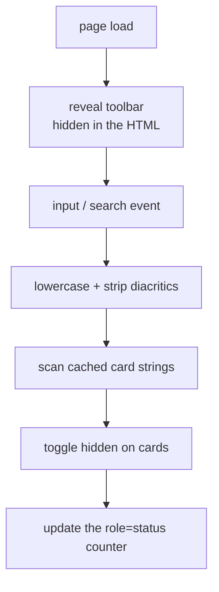

`wwwroot/js/menu-search.js` is ~115 lines of dependency-free JavaScript.

1. On load it caches one normalised search string per card (name + description + category), so each
   keystroke is a linear scan with no repeated DOM reads.
2. Normalisation lowercases and strips diacritics (`NFD` + combining-mark removal), so "crème" and
   "creme" both match.
3. Non-matching cards are hidden with the `hidden` attribute and stay in the DOM.
4. The live counter announces `Showing 3 of 16 dishes`, using the menu-wide total from
   `data-total-items`. Reading the card count instead would rewrite "of 16" to "of 5" on a
   category-filtered page.
5. The toolbar ships `hidden` and is revealed here. A search box that cannot search is worse than
   none, so it never appears without JavaScript.
6. `Escape` and the native clear control reset the field; a hidden empty state offers "Clear search".

The dataset is small and fully rendered, so filtering on the client is instant and composes with the
server-side category filter for free. The limitation is that search only filters the current page;
pagination would move it server-side.

---

## 10. Design system and brand palette

The brief asks for King Price's palette. Public sources only call the brand colour "royal red"
without codes, so the tokens were taken from **King Price's own production stylesheet**
(`kingprice.co.za/css/bundles/site.min.css`). Popular colour-name sites suggest `#AB2330` or
`#9B1C31`; the real primary red is `#B10F1F`.

| Token | Hex | Source token | Used for |
|---|---|---|---|
| `--red` | `#B10F1F` | `--colour-primary-red` | Primary actions, active pills, eyebrows, focus rings |
| `--red-deep` | `#8B010E` | `--colour-red-shade` | Prices, hover states, gradient end |
| `--red-bright` | `#D6001C` | accent | Header gradient start |
| `--red-tint` / `--red-tint-2` | `#F8EAEB` / `#FDF4F5` | `--colour-red-tint-*` | Hero and media gradients, hover fills |
| `--gold` | `#FFD73B` | `--colour-yellow` | Crown mark, header rule, hero glow |
| `--gold-mid` | `#E1C06E` | `--colour-golden-yellow-1` | Accent underline on the hero heading |
| `--gold-deep` | `#C69C33` | `--colour-golden-yellow-2` | Filled stars (contrast-safe on white) |
| `--green` family | `#58AB74` / `#E1F6EA` / `#006A2C` | seagreen tokens | Vegetarian badge, starter artwork |
| `--blue-tint` | `#EEF4FD` | derived from `--colour-blue-1` | Drinks artwork |
| `--ink` | `#2A2A2A` | near-black | Body copy and headings |
| `--grey-700` … `--grey-100` | `#474747` … `#F0F0F0` | `--colour-grey*` | Secondary text, borders, surfaces |

Visual system:

- **Type**: system UI stack only (`system-ui`, Segoe UI, Roboto). No webfonts, so the page renders
  instantly and works offline. Headings use `-0.02em` tracking; body copy is 16 px at 1.6 line height.
- **Layout**: a `1160px` shell with 24 px gutters, and a grid of `repeat(auto-fill, minmax(258px, 1fr))`
  that reflows without breakpoints.
- **Colour coding**: a category-tinted gradient backs each card's media box, keyed off
  `data-category` — green for starters, red for mains, gold for desserts, blue for drinks. It is the
  fallback artwork when an item has no photograph, and remains the loading surface behind one.
- **Motion**: 150–180 ms transitions, all disabled under `prefers-reduced-motion: reduce`.
- **No framework**: the stylesheet is hand-written and sectioned (base, header, filter, buttons,
  page heads, hero, sections, cards, badges, detail, empty states, footer, responsive, print). It is
  deliberately one file: without a bundler, splitting it would add a render-blocking request per file
  and hide cascade order in the markup. The banner comments are the split lines, so it can be cut up
  later without hunting for where a rule lives.

---

## 11. Accessibility

| Concern | Implementation |
|---|---|
| Landmarks | `header`, two labelled `nav` elements, `main`, `footer` |
| Skip link | First focusable element, visible on focus, targets `#main` (`tabindex="-1"`) |
| Heading order | One `h1` per page. Cards are `h3`, so each grid sits in a labelled `<section>` with a visually hidden `h2`; the empty panel takes its level from its view model (`h2` at page level, `h3` inside a section); no page skips a level, and a test walks the outline of every route |
| Current location | `aria-current="page"` on the active category pill only |
| Photographs | `alt=""` plus `aria-hidden="true"` on the media box: the dish name is the link text and the `h1`, so a description would announce every dish twice. See below. |
| Icons | Decorative emoji marked `aria-hidden`; the wordmark carries the brand name |
| Star ratings | `role="img"` with `aria-label="4 out of 5 stars"`; glyphs hidden |
| Search | Labelled input and a `role="status"` live region for result counts; a `<noscript>` note explains that search needs JavaScript while the server-side categories do not |
| Language | `<html lang="en-ZA">`, so a screen reader uses South African English pronunciation for the rand prices and local dish names |
| Focus | `:focus-within` paints a **solid** 3 px `#B10F1F` ring (~7:1 against the page) on cards; the link's own outline is suppressed because `overflow: hidden` would clip it |
| Motion / print | Reduced-motion disables transitions; print hides chrome, filters, buttons and footer |
| Forced colours | Windows High Contrast replaces the palette, so a `forced-colors: active` block restores borders on cards, badges, pills and panels; photographs keep their own colours instead of being flattened |

### 11.1 Photograph alt text

Every `` in the app carries `alt=""`, and that is the deliberate answer rather than an omission:

- The dish name is already the card's link text and the details page's `h1`. A screen reader therefore
  announces "Beef Carpaccio, link" once, not "Beef Carpaccio, image of aged beef, link".
- The photograph adds no information the name does not carry. WCAG treats images that duplicate an
  adjacent caption as decorative, and decorative images must have an empty `alt` so assistive
  technology skips them.
- The container is also `aria-hidden="true"`, which covers the fallback glyph the same way.

An integration test asserts that every rendered card image has `alt=""` and `loading="lazy"`, so the
rule cannot drift back to a filename or a description. If the design ever showed a photograph without
the dish name — a gallery, or a link preview — that image would need real alternative text, which
would mean an `alt` field on the item rather than a blanket rule.

The layout is usable at 200% zoom and at 414 px width, with no horizontal scroll (verified in-browser).

---

## 12. Testing

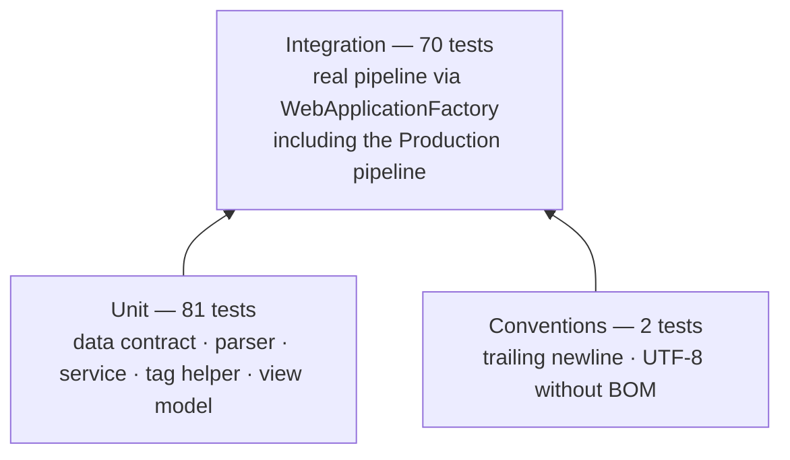

Unit tests pin down the JSON contract, the loader's failure modes, filtering, the specials rotation
and the tag helper's markup. Integration tests boot the real app in memory and assert on rendered
HTML: routing, query strings, status codes, Razor composition, the photograph mapping, and "no CSS
framework" as an executable rule. Test doubles are hand-written — a stub `IWebHostEnvironment`, a
temp-directory helper, a fake service, and the factory. No mocking framework, no snapshot library.

| Test class | Tests | Focus |
|---|---|---|
| `MenuJsonReaderTests` | 29 | Deserialisation, ordering, every validation rule, category errors, price formatting, `imageFile` acceptance and rejection |
| `MenuCategoryParserTests` | 18 | Case and whitespace tolerance; rejection of numeric, combined and unknown values |
| `JsonMenuServiceTests` | 20 | File resolution, missing/invalid files, image existence at startup, read-only guarantees (lists, categories and counts), filtering, specials |
| `MenuHealthCheckTests` | 2 | Healthy and unhealthy branches of `/health` |
| `StarRatingTagHelperTests` | 6 | Filled stars, `role`/`aria-label`, decorative glyphs, clamping |
| `EmptyStateViewModelTests` | 6 | Heading-level default, opting down to `h3`, rejection outside 2–6 |
| `MenuEndpointsTests` | 56 | Home, grid, filtering, malformed categories and ids, 404s, shared nav (including repeated and stray `?category=`), heading order, status-page codes and headers, security headers, toolbar, no framework CSS |
| `MenuImageTests` | 6 | Every item is mapped, names are unique and id-prefixed, disk and JSON agree, cards carry `alt=""` and `loading="lazy"`, the detail hero is eager, every URL serves a real JPEG |
| `EmptyStateRenderingTests` | 4 | Both empty panels rendered for real (`h2` at page level, `h3` inside a section), with the outline re-checked |
| `ErrorPipelineTests` | 4 | Production only: unhandled exception → 500 friendly page with no stack, recovery afterwards, HSTS, direct `/Home/Error` |
| `RepositoryConventionsTests` | 2 | No file ends with a newline; every file is UTF-8 without a BOM |

```bash
dotnet test
dotnet test --filter "FullyQualifiedName~MenuEndpointsTests"
dotnet test --filter "FullyQualifiedName~MenuImageTests"
dotnet test --collect:"XPlat Code Coverage"
```

Not covered: the JavaScript search (verified manually in a browser; Playwright is the natural next
step), visual regression and cross-browser CSS, and the health check's unhealthy branch end-to-end
(it is unit-tested against a fake service, because an empty menu would require replacing the
singleton at startup).

---

## 13. Operational notes

### Configuration

```json
{
  "MenuData": {
    "FilePath": "Data/menu.json"
  }
}
```

- Relative paths resolve against the content root; absolute paths are used as-is.
- The content root is anchored to `AppContext.BaseDirectory`, so the app finds its own data and
  settings regardless of the launch directory — the framework default (current working directory)
  is a common "works with `dotnet run`, breaks as a service" bug.
- Override for containers: `MenuData__FilePath=/etc/menu/menu.json`.

### Logging and health

Startup logs one structured line:

```
info: MenuExplorer.Services.JsonMenuService[0]
      Loaded 16 menu items across 4 categories from <content root>/Data/menu.json
```

Bad data logs nothing and fails the host with a `MenuDataException`. The same is true of a mapped
photograph that is not on disk — the message names the file, the item id and the item name, and the
list of every other missing file, so one restart fixes the whole set. `GET /health` runs the
`menu-data` check and returns `Healthy` (200) or `Unhealthy` (503), suitable as a readiness probe.

### Caching and scaling

The menu is loaded once per process and served from memory, so requests do no file I/O. Every
collection the service hands out is a `ReadOnlyCollection` or `ReadOnlyDictionary` wrapper, which
makes the "immutable at runtime" claim a runtime guarantee rather than a convention: `IReadOnlyList`
and `IReadOnlyDictionary` are interfaces, so without the wrappers a caller could downcast to the
backing `List`/`Dictionary` and mutate the singleton. Tests assert that lists, categories and
category counts all throw `NotSupportedException` on mutation. Category counts are precomputed at
load, so the global navigation does no filtering per render. The app is stateless and scales
horizontally without coordination: the JSON is read-only and every instance loads the same file.

Assets are served through `MapStaticAssets`. The stylesheet and the search script are referenced with
`asp-append-version`, so their URLs carry a fingerprinted tag and can be cached aggressively. Dish
photographs are referenced by their plain path — `imageFile` is data, not a tag-helper expression —
so they are revalidated rather than fingerprinted; replacing a photograph in place may need a cache
refresh, while adding one under a new name does not.

### Hardening

HSTS, the exception handler and HTTPS redirection are wired for non-development environments. Note
that `UseHttpsRedirection` cannot redirect when it cannot discover an HTTPS port, so a reverse-proxied
deployment must set `ASPNETCORE_HTTPS_PORT` (or configure `HttpsRedirectionOptions`) for it to take
effect; TLS termination at the proxy is the alternative. No
secrets exist in the app; the only external input is the JSON file, read once at startup.

`SecurityHeadersMiddleware` adds the baseline headers to every response, including 404s and 500s:

| Header | Value | Why |
|---|---|---|
| `Content-Security-Policy` | `default-src 'self'; …; frame-ancestors 'none'` | The app loads no third-party asset, has no inline `<style>`, no `style=""` attribute and no inline script, so `'self'` is the whole allow-list. Any future CDN or inline snippet will be blocked on purpose. |
| `X-Content-Type-Options` | `nosniff` | Stops a browser second-guessing the declared content type. |
| `X-Frame-Options` | `DENY` | Framing is never intentional here; sent alongside `frame-ancestors` for older browsers. |
| `Referrer-Policy` | `same-origin` | Keeps the path out of outbound requests. |

An integration test asserts all four on a 200, a 404 and a 500, and asserts the policy contains no
`'unsafe-inline'`. Three boundaries are also enforced in code rather than documented as good
intentions: the unknown-category value echoed into the page is truncated to 40 characters at the
controller (backing off a surrogate pair rather than cutting one in half), the status page only
renders a value the middleware could actually have produced — anything outside `400`–`599` becomes a
500 page, never "HTTP 0" — and `/Home/Error` sets 500 itself so a direct hit is not reported as a
success.

### Diagnosing a failure

Every C#, Razor, JavaScript and CSS file opens with a flowerbox naming its role, its layer, and the
thing worth knowing when it misbehaves. When something breaks, start here:

| Symptom | Look at |
|---|---|
| App exits immediately with a long message | `MenuDataException` from `JsonMenuService` — the message names the file, the setting and the offending item |
| App exits naming an image file | The `imageFile` in `Data/menu.json` has no matching file in `wwwroot/images/menu/`, or a name/path mismatch after a rename |
| A card shows the emoji instead of a photograph | That item has no `imageFile`; the glyph is the fallback, not an error |
| `Data/menu.json` not found after publish | Content root, pinned to `AppContext.BaseDirectory` in `Program.cs` |
| Photographs 404 under `dotnet run` | `wwwroot` is resolved from the project directory when `bin/` has none — see the web-root comment in `Program.cs` |
| A category filter shows the full menu | `MenuCategoryParser.TryParse` — only exact declared names match; numeric and combined values fall back on purpose |
| A category pill highlights nothing | `_CategoryNav.cshtml`, where the active state is read from `MenuNavigationContext` — if it is wrong, the controller failed to call `MarkMenuPage` |
| Search box is missing | `menu-search.js` failed to load: the toolbar ships `hidden` and only the script reveals it, so an absent box means an absent script |
| Counter says "of 5" instead of "of 16" | `data-total-items` on the grid in `Menu/Index.cshtml` |
| Rating renders as plain text | `@addTagHelper *, MenuExplorer` in `Views/_ViewImports.cshtml` |
| Startup log line is missing | `JsonMenuService` was never resolved — the fail-fast call in `Program.cs` is what forces the load |

---

## 14. Design decisions and limitations

| Decision | Alternative | Why this way |
|---|---|---|
| JSON loaded once into a singleton | Read per request; watch for changes | Read-only reference data; per-request I/O adds latency for no benefit. Data edits require a restart. |
| `MenuCategory` enum, name-only parsing | Free-text category, or `Enum.TryParse` | Typos fail loudly at startup; numeric and combined inputs cannot silently resolve to a section. |
| Fail fast at startup | Lazy load on first request | A bad deploy is caught immediately rather than by a visitor. |
| Card as a partial, exposed again as a ViewComponent | Duplicate markup, or a component everywhere | Satisfies both requirements with one source of truth; the grid uses the simpler mechanism. |
| Category nav injects `IMenuService` for counts, and `MenuNavigationContext` for the current section | Populate a shared property in every action, or re-parse the URL in the partial | Global chrome stays global, while the one value it shares with a page still comes from the controller that resolved it. Scoped to navigation only. |
| Client-side search | Server-side `?q=` filter | Instant, no round trips, composes with category filtering. Fine at 16 items; would change with pagination. |
| Hand-written CSS with custom properties | Bootstrap or a utility framework | Required by the brief; tokens also make the brand palette auditable in one place. |
| Conventional routing | Attribute routing | URLs are fixed and obvious; `Program.cs` stays the single routing map. |
| `TimeProvider` injection | `DateTime.Today` | The specials rotation is deterministic in tests without freezing the clock globally. |
| Content root = `AppContext.BaseDirectory` | Framework default | File resolution stays predictable for published apps and services. |
| Explicit types instead of `var` | Type inference | Removes a reading step in review, especially at the Razor boundary. Costs a little verbosity. |
| Read-only collection wrappers | Return the backing `List<T>` / `Dictionary<,>` | `IReadOnly*` is only an interface; wrapping makes the singleton's immutability enforceable and testable. |
| Photographs mapped by file name in the JSON | Derive the file name from `Id` in code | Renaming a dish or swapping a photograph stays a data edit; the `imageFile` value is validated as a bare name and checked on disk, so it cannot point outside the folder. |
| Images served as static files | A resizing endpoint, `ImageSharp`, or `srcset` | 16 pre-sized files at 51–78 KB need no runtime cost or extra dependency. A `srcset` would matter only with much larger audiences or slower links. |
| Search toolbar hidden until JavaScript runs | Render the input unconditionally | A focusable control that does nothing is worse than an absent one, so the toolbar ships `hidden` and a `<noscript>` note points at the category filter that still works. |

Known limitations:

- **No live reload.** Changing `menu.json` requires a restart or redeploy; a `FileSystemWatcher` plus
  cache refresh would fix it if the menu became editorially live.
- **Single currency and locale.** Prices are ZAR, formatted with the invariant culture on purpose.
- **Photographs are one size.** There is no `srcset` or format negotiation, so a phone downloads the
  same 1136 px file as a desktop. Fine at ~70 KB per image; a larger menu would want resized variants.
- **Search is client-side only** and does not survive pagination.
- **No admin/CRUD surface.** The JSON file is the CMS; persistence is out of scope.

---

## 15. Stretch goals

| Goal | Status | Where |
|---|---|---|
| Item card as a ViewComponent | ✅ Implemented, partial retained as the single markup source | `ViewComponents/`, `Views/Shared/Components/` |
| Custom tag helper | ✅ `<star-rating value="4" />` with clamping and accessible output | `TagHelpers/StarRatingTagHelper.cs` |
| Client-side search | ✅ Progressive enhancement with a live result count | `wwwroot/js/menu-search.js` |
| Friendly empty state | ✅ For empty categories and empty searches | `Views/Shared/_EmptyState.cshtml` |

Beyond the brief: fail-fast data validation, a health endpoint, structured logging, typed view
models, shared error/status pages, security headers, reduced-motion, print and forced-colours styles,
an enforced formatting convention, and 153 automated tests.